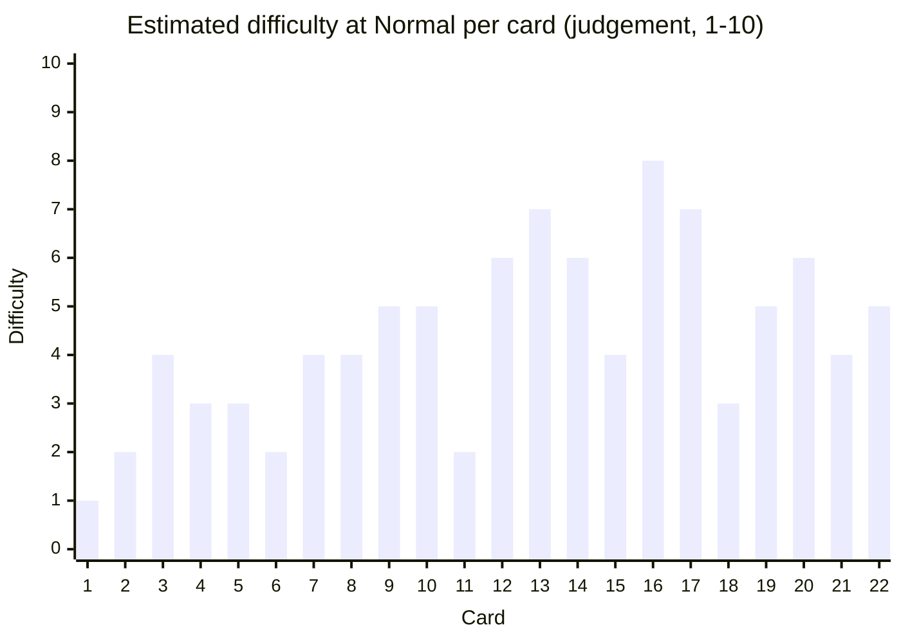

# Out of Sight - Level design and difficulty review (LEVELREVIEW)

Date: 2026-11-24. Scope: the 22 cards of `Assets/Resources/Levels/levels.json` (rev 2), in played order. Analysis only:
no level, code or test was changed, no Unity run.

**Naming.** Every level is named "Card N (fileX, title)". Card N = `levels[N-1]`. Titles come from `Core/Strings.cs`.

**Legend.**
- **[M]** = measured: read from an audit log, audit JSON or a progress report (source given).
- **[D]** = read from the level JSON (data, not a measurement).
- **[J]** = my judgement.
- "slack" = the audit `-slack` value in 0.1 s samples. "margin" = the route shift tolerance (early / late, s) when no
  slack was measured.

**Main sources.**
- Strict audit of all 22 levels at both difficulties: `Build/HUMANAUDIT_r3.log` and `Build/next/HUMANAUDIT_strict.json`
  (2026-11-22).
- Newer runs:
  - `Build/doors.log` and `doors18.log` (cards 10, 11, 12, 14, 15, 20 after the doorway moves);
  - `Build/LEVELS6_W8.log` (card 8);
  - `Build/l13.log` (card 13);
  - `Build/l16_r3.log` (card 16).
- Rush probe table: `Build/levels_v2/rush_probe.txt` (2026-11-23).
- Progress reports: `docs/levels_v2/progress/*.md` and `docs/next/progress/*.md`. The specification: `docs/levels_v2/LEVELS_V2.md`.

---

## 1. Executive summary (ranked)

1. **Act 3 is mostly unreworked, and the curve collapses after card 17.**
   - Four of the six act 3 cards ship the v1 files: card 18 (level21), 19 (level20), 20 (level22) and 22 (level24).
     These files have no `pace` field and no `rev`, so their "0 defects" never checked the pace rules [D].
   - Cards 18 and 22 need almost no waiting: 5 % and 2 % waiting share, one 0.6 s pause each [M].
   - The finale (card 22) plays easier than the act 2 exam (card 16) and easier than the act 3 opener (card 17) [J].
   - **Recommendation:**
     - take card 18 out of the line-up now;
     - reorder act 3 so it opens on the Showroom (card 21, after its rush fix);
     - rework the finale from the best variant already built (LV13_q2), with relaxed targets.
2. **Seven hints are false on the shipped data** [D]. Six were written for the v2 designs that never shipped:
   - card 11: "Lea can see the doormat";
   - card 13: "Max watches the front door";
   - card 18: "never looks twice at an office chair" (the file has no decoy);
   - card 19: "Maman paces the corridor" (she stands for 320 s);
   - card 20: "Alfred never stands still" (he stands for 40 s);
   - card 22: "Rex walks the landing, Lea keeps the hall".

   The seventh is card 8. Its hint says "the kitchen is quicker". At Normal the corridor is quicker: 17.4 s against
   20.9 s [M]. Rewriting these strings is the cheapest and highest-value fix in this review.
3. **Card 11 (level11, The Vase) is not a stealth level.**
   - Measured: 2 % waiting, 0 pauses, exit 15.0 s [M].
   - Rush (a) wins at 12.4 s and rush (c) at 8.2 s [M].
   - The LEVELS_V2 retune of Lea was never attempted. Task LV6 left no progress file, and Lea's stations differ from
     the spec [D].
   - It sits in the middle of act 2 as a dip.
4. **Card 16 (level17, the exam) is fair only for a player who starts at once.**
   - There is one crossing beat per 68.2 s loop.
   - The late-start sweep finds no schedule without a wait over 8 s for any start from about 15-18 s up to 66 s.
     That is 17 or 18 of the 23 sampled start times [M].
   - With AUTOSTART, a player who reads the three-sentence hint is likely to miss the beat and wait up to about 50 s
     with no cue [J].
   - It is also the steepest step of the game: estimated 4 at card 15, then 8 at card 16 [J].
5. **AUTOSTART exposes phase problems that the audit only half measures.**
   - The start-delay sweep runs by default on cards 1-7 only. Its failures are warnings [M].
   - Card 5 fails for starts at 2-4 s, the very moment a player dismisses the card [M]. This needs a check by hand.
   - Stars and records start at the first input, so waiting under the card is free time [J].
   - **Recommendation:** run `-sweep` on every level, and make "a safe idle spot with a readable cue within 15 s" a
     design rule.
6. **The pace gate measures the solver, not the player.**
   - Cards 9 and 21 reach their pause minimum with 0.6-0.7 s micro-stops [M]. The old card 16 file (before L16EASY)
     did the same.
   - Cards 6 and 13 reach it only through the spawn wait [M].
   - The route shift margin sits at the 0.3 s minimum on 15 levels [M].
   - The rush probe is blind after the spawn on card 13: all three rushes are caught in under 1 s at the start, so the
     other 32 s are untested [M].
   - **Recommendation:**
     - count pauses of at least 1.0 s;
     - add a rush variant that keeps the spawn wait then rushes;
     - add a "windows per loop" metric.
7. **Difficile is mostly the same puzzle, yet its 1.15 view-range factor killed every v2 rework.**
   - 14 of 22 levels have the same audit exit at both difficulties [M].
   - The v2 attempts on cards 16, 19, 20 and 22 all died at Difficile, through the x1.15 range (Lea 11.5 m, Maman
     11.5 m, Theo 9.2 m) [M].
   - Consider a smaller range factor, or Difficile through grace, suspicion and creak only (code S, re-audit L).
8. **Smaller but visible.**
   - Card 3 has the lowest slack measured in the game (3) at the third slot [M].
   - Card 21 is a night level where night means nothing for sight (visual only), right after the only level where
     darkness matters [D]. Its rush (a) wins [M].
   - Cards 19 and 20 have inhabitants walking through the player's waiting cell: 0.19 m and 0.29 m [M].

---

## 2. Difficulty curve

### 2.1 Table (Normal; Difficile in brackets where it differs)

Watchers:
- H = human, with personality: def(ault), dre(amer), wat(chful), hur(ried), gra(nny), tidy;
- D = dog;
- R = robot.

Difficulty is my judgement [J]. It is based on:
- slack or margin;
- forced waits and pauses;
- the number of clocks to align;
- handling (careful, load, glide);
- route length;
- the rush results.

All other columns are measured [M] unless marked.

| Card | File, title | Furniture | Watchers | New mechanic or lesson | Diff | Exit s | Wait share | Pauses all (mid) | Tightest slack / margin |
|---|---|---|---|---|---|---|---|---|---|
| **Act 1** | | | | | | | | | |
| 1 | level1, The Living Room | chair | 1 H def | facing, freeze | 1 | 12.0 | 27 % | 1 (0) | slack 15 |
| 2 | level2, The Hallway | chair | 1 H def | hearing, rug | 2 | 13.3 | 31 % | 1 (0) | 15 |
| 3 | level3, The Dining Room | chair | 1 H def | memory + decoys | 4 | 20.2 | 45 % | 2 (1) | **3** (N and D) |
| 4 | level4, The Stool | stool | 1 H def (seated) | careful pace, topple | 3 | 14.9 | 33 % | 2 (1) | 8 (D 7) |
| 5 | level5, The Armchair | armchair | 1 H def | sat on | 3 | 16.6 | 38 % (pinned 2.2 s) | 3 (2) | 8 |
| 6 | level6, The Lamp | floor lamp | 1 H def | dark range, switch | 2 | 19.0 (20.8) | 20 % (26 %) | 1 (0) | 15 |
| 7 | level7, The Office | office chair | 1 H def (pacing) | glide | 4 | 19.3 | 50 % | 2 (1) | 8 |
| **Act 2** | | | | | | | | | |
| 8 | level8, The Doors | chair | 1 H dre | door leaves, route choice | 4 | 17.4 (20.9) | 24 % (44 %) | 3 (2) | margin 0.3/0.3; slack not re-measured |
| 9 | level9, The Robot | chair | 1 H wat + R | robot hum, personalities | 5 | 19.3 | 30 % | 4 (3), mids 0.6-0.7 s | 8 |
| 10 | level12, The Dog | stool | 1 H dre + D | dog low eye, sofa cover | 5 | 23.3 | 40 % | 3 (2) | 5 (before the doorway move) |
| 11 | level11, The Vase | chair + vase | 1 H tidy | load | **2** | 15.0 | **2 %** | **0 (0)** | not measured; margin 0.4/3.0; **rush wins** |
| 12 | level15, Let Sleeping Dogs Lie | rocking chair | 1 H gra + D (naps) | rock, nap, motion-only dog | 6 | 27.1 (27.5) | 31 % | 4 (3) | 6 |
| 13 | level13, Wheels and a Vase | office chair + vase | H hur + H wat | glide + load, 2 watchers | 7 | 38.6 | 42 % | 4 (3) (D 5 (4)) | not measured; margin 0.3/0.3; vase 0.20 m/s from a fall |
| 14 | level14, The Mezzanine | armchair | H gra + H tidy (wander) | split level, sit deadline | 6 | 44.8 | 24 % | 4 (2) | 5 |
| 15 | level18, The Wardrobe | stool | 1 H tidy (metronome) | wardrobe hide | 4 | 21.7 | 47 % | 2 (1) | 6 |
| 16 | level17, The Whole House | chair + vase | H gra + H tidy + D + R | exam (door, pet, split, hum, load) | **8** | 34.6 (35.9) | 26 % | 6 (4) | 9 (D 7) |
| **Act 3** | | | | | | | | | |
| 17 | level19, Hide and Seek, Family Size | stool | H wat + H dre | wardrobe against 2 threats | 7 | **72.0** | 35 % | 6 (5) | 5 |
| 18 | level21, The Catwalk (v1) | office chair | H wat + H tidy + H hur + R | catwalk | **3** | 19.0 | **5 %** | 1 (1) | not measured; margin 0.4/3.0 |
| 19 | level20, Midnight Munchies (v1) | floor lamp | H wat + H dre + D | night, door memory | 5 | 55.3 (57.2) | 14 % (17 %) | 2 (1) | not measured; margin 0.3/0.3 |
| 20 | level22, Skeletons in the Closet (v1) | stool | H wat + H hur + H gra | wardrobes + door memory | 6 | 50.1 (**68.6**) | 31 % (40 %) | 4 (3) (D 6 (5), max 7.0 s) | not measured; margin 0.3/0.3 |
| 21 | level25, The Showroom | chair | 2 H hur (1 wander) | decoy grid | 4 | 29.9 (30.9) | 39 % | 5 (4), two mids 0.6-0.7 s | 11 (D 10); **rush wins** |
| 22 | level24, The Great Escape (v1) | stool | H wat + H dre + H gra + D + R | finale | 5 | 40.4 (40.9) | **2 %** | 1 (1), 0.6 s | not measured; margin 0.4/1.1 |

Where each number comes from:
- most cards: `HUMANAUDIT_r3` (strict);
- cards 10, 11, 12, 14, 15 and 20: `doors.log`;
- card 8: `LEVELS6_W8`;
- card 13: `l13.log`;
- card 16: `l16_r3.log`;
- slack values: the LV1-LV13 and AUDFIX progress reports.

The waiting share and the pause count follow LEVELS_V2 1.3:
- time sat on is left out;
- a pause is a stop of at least 0.5 s;
- "mid" means after the first move.

The sum of all audit exits is about 624 s, that is 10.4 min of perfect play for the whole game [M].

### 2.2 Chart (estimated difficulty at Normal, judgement)



The same chart in text form:

```
Act 1   1 #
        2 ##
        3 ####          <- spike: memory + decoys, slack 3
        4 ###
        5 ###
        6 ##            <- dip: 0 mid-route pauses
        7 ####
Act 2   8 ####
        9 #####
       10 #####
       11 ##            <- dip: v1 file, 2 % waiting, rush wins
       12 ######
       13 #######
       14 ######
       15 ####          <- planned new-verb dip (fine)
       16 ########      <- exam, +4 in one step
Act 3  17 #######       <- opens at the act's peak, 72 s
       18 ###           <- collapse: v1, 5 % waiting
       19 #####
       20 ######
       21 ####          <- rush wins
       22 #####         <- finale below the exam
```

### 2.3 Critique of the curve [J unless marked]

- **Act 1 zigzags** (1, 2, 4, 3, 3, 2, 4).
  - The spike is card 3. It teaches two rules at once (memory, decoys) and carries the tightest timing in the game
    (slack 3 [M]).
  - Card 6 is a dip: the lamp only switches off and walks; the spawn wait is its only pause [M].
  - The act does end on a solid card (7).
- **Act 2 ramps, with one hole.**
  - Card 11 (v1) drops to 2 between two 5s and a 6.
  - Card 13 at 7 is the hardest before the exam. It is harder than card 14, which is longer only because the armchair
    is slow (LEVELS_V2 says so itself).
  - Card 15 is the planned dip before the exam. But the jump from 15 to 16 (+4) is the largest step of the game: from
    one metronome watcher to four threats on a 68 s loop.
- **Act 3 has no shape.**
  - It opens on its hardest and longest level (card 17, 72 s, twice the exam's clock [M]).
  - It falls to 3 at card 18, then wanders between 4 and 6.
  - The finale (5) is below the exam (8) and below the opener (7).
  - The act 3 average is 5.0, against 5.2 for act 2. The game gets no harder after card 16.
- **Too many new things at once:**
  - card 9: robot, hum masking and the first watchful hearing;
  - card 12: rocking chair, a napping dog, a dog that sees motion only, and the granny;
  - card 14: platform, a second sit used as a soft deadline, and the first wandering routine;
  - card 15: wardrobe, door memory (`doorMemory: true` [D]) and a household door, with only the wardrobe in the hint;
  - card 19: the lamp after 13 cards, plus night, door memory, a household door, a dog and wardrobes the lamp fits in.
- **Introduced, then dropped or parked:**
  - the rocking chair (card 12 only);
  - the rug as a puzzle (it binds only on card 2);
  - the lamp: cards 6 and 19 only, and 19 is the v1 file without the D18 re-teach;
  - lit zones, `exitwatch` and the player-locked door were built for v2 but no shipped level uses them [D].
- **Normal against Difficile.**
  - 14 of 22 levels have the same audit exit at both difficulties [M]. For a perfect route, Difficile only tightens
    grace (0.14 s), suspicion (x1.5) and creak (16 s), not the puzzle.
  - The real gaps:
    - card 20: +18.5 s, with a 7.0 s pause [M];
    - card 8: the route flips from the corridor to the kitchen, with a 7.2 s spawn wait [M];
    - card 16: slack 9 at Normal, 7 at Difficile [M].
  - On the other side, every blocked v2 variant of cards 16, 19, 20 and 22 died at Difficile only [M]. The 1.15 range
    factor shapes level design more than it shapes play.

---

## 3. Per-level critique

### Card 1 (level1, The Living Room)
- **Intent:** one default watcher. Move only when nobody looks.
- **Works:**
  - 12.0 s, slack 15, both rushes lose (caught at 1.3 s and 2.0 s) [M];
  - the tips fire here;
  - pure facing with no cover is honest (LEVELS_V2 12).
- **Problems:**
  - The designed beat (D11: "first freeze mid-route as he looks at the door") is not in the schedule. There are 0
    mid-route pauses; the only wait is 3.2 s at the spawn [M]. The first thing the game teaches is "wait at the start",
    not "freeze when he turns" [J].
  - Late start: no schedule without a wait over 8 s for starts at 27-33 s of the 37.3 s loop [M]. This is rare but
    possible under AUTOSTART.
- **Fixes:**
  - Make s1 (1.2, 1.4) glance (1, 60, 0.8) longer (hold 1.5), or move s3 (2.2, -0.7) glance (2, -80, 1) so it sweeps
    the route's midpoint. Target: one mid-route freeze of 1-2 s (S).

### Card 2 (level2, The Hallway)
- **Intent:** hearing. Creep on the runner rug.
- **Works:**
  - the rug is required, with 31 rug samples in earshot and no schedule without it [M];
  - slack 15; rushes caught at 0.2 s [M].
- **Problems:**
  - The start station s2 (2.25, 1.6), facing 180, looks straight at the spawn [M STARTFIX]. Under AUTOSTART the chair
    is unseen before the first input, so this is a good readable opening.
  - 0 mid-route pauses [M]: the rug crossing simply happens during s0's 7 s back turn.
  - The prop named "Wardrobe" is a 2.0 m cabinet [D]. After card 15 it looks hideable: the same issue the user flagged
    on card 17 [J].
- **Fixes:**
  - None urgent.
  - Optional: make "Wardrobe" a bookshelf, or a 0.9 m dresser, so that "tall closed box = hideable" stays true
    everywhere (XS look, plus one audit run for occlusion).

### Card 3 (level3, The Dining Room)
- **Intent:** memory plus decoys. Park beside another chair.
- **Works:**
  - decoys are required [M];
  - the decoy tip fires here;
  - the hint is precise.
- **Problems:**
  - **Slack 3 at both difficulties** [M], the lowest measured in the game, on slot 3 (target 8-12). LV2 escalated it at
    the run cap.
  - The 5.2 s rest at (0.25, 0.25) beside decoy (0.77, 0.25) must start inside a 0.3 s margin [M].
  - Late start: phases 7-12 s of the 44.1 s loop need a wait over 8 s [M]. A player reading the longest hint of act 1
    lands there [J].
  - Six decoys, but only the doorway one matters [D]. Nothing shows that decoys fool default watchers only (tolerance
    0.75, against 0.5 for watchful and 0.4 for tidy).
- **Fixes:**
  - LV2 measured slack 6/9 with s0 x -2.25 and dwell 4.5, but a decoy-free route then existed.
    - Keep dwell 4.5.
    - Close the decoy-free stop instead: a glance from s2 (2.9, 0.2) toward the doorway cells (-0.25..0.25, 0.25),
      or the Dresser (0.75, -1.25) lengthened to screen them.
    - Target slack 6 or more (M).
  - Fallback (XS): swap cards 3 and 4, so the second new rule set comes one level later.

### Card 4 (level4, The Stool)
- **Intent:** careful pace or the stool topples.
- **Works:**
  - careful is required, slack 8/7, two clear pauses [M];
  - it is short.
- **Problems:**
  - The spec's twist is "creep low along the bench". But the 0.5 m Bench is no cover from a seated human (eye at
    1.15 m), and height is never cover from humans (LEVELS_V2 12). A player may learn a false rule [J].
- **Fixes:**
  - None in data.
  - Keep the hint about speed only, as it is now.

### Card 5 (level5, The Armchair)
- **Intent:** be on your spot when he wants to sit.
- **Works:**
  - sit binds, pinned 2.2 s, 3 pauses, slack 8 [M];
  - the joke lands.
- **Problems:**
  - Late start: no schedule without a wait over 8 s for starts at **2-4 s** and at 21-31 s of the 39.8 s loop [M].
    2-4 s is the typical card dismissal.
    - Probably an artefact: the search's 8 s anchor still counts pinned time (RULEFIX) [J].
    - Needs a check by hand.
  - The spawn is the seat home [D]. A player who never moves may win the same way, so "be back in your spot" is never
    tested [J, unverified].
- **Fixes:**
  - Spawn the armchair 1.5 m off its seat. The seat stays at (-3.25, 0.25); the player starts at (-3.25, -1.25). The
    first decision is then the hint's: return before s1 (M).

### Card 6 (level6, The Lamp)
- **Intent:** in his cone, in the dark, nothing happens.
- **Works:**
  - dark binds, one toggle, slack 15 [M].
- **Problems:**
  - 0 mid-route pauses and 20 % waiting [M]: "switch off, then walk".
  - The dark moment is marginal. The audit's synchronised dark check warns: closest in-cone pass 0.3 m beyond the 4.0 m
    dark range, at 16.0 s [M].
  - At 0.6 m/s, 15.3 s of the 19.0 s is travel [M].
  - s0 dwell is 16 s, against 10 s in the spec [D].
- **Fixes:**
  - Time s0's second glance (7, -40, 1.5) to fall when the lamp is 4.5-6 m away, mid-route. The lamp must then stand,
    switched off, inside his lit cone for 2-4 s: the spec's "dark-boundary pause" (M).

### Card 7 (level7, The Office)
- **Intent:** the office chair glides. Stop early beside a decoy.
- **Works:**
  - glide binds (6 glide stops), decoys explain 24 samples, 50 % waiting, two clear pauses [M];
  - the pacing watcher is readable;
  - the 5.4 s spawn wait under his gaze at 1.35 m is a good joke.
- **Problems:**
  - Late-start phases 10-13 s of the 17.3 s loop (23 % of it) need a wait over 8 s [M]. That is acceptable.
- **Fixes:**
  - None.

### Card 8 (level8, The Doors)
User feedback: OK.
- **Intent:** closed leaves, a door seen swinging, a first route choice.
- **Works:**
  - door binds; both routes are viable [M]: corridor x1.00, kitchen x1.20 at Normal;
  - Paul's back station s1 (5.75, 2.25), facing 250, stops the tail.
- **Problems:**
  - **The hint is backwards at Normal.** The corridor is quicker (17.4 s), the kitchen slower (20.9 s) [M]. At
    Difficile the kitchen wins (20.9 s against 21.3 s).
  - Normal and Difficile play as two levels [M]:
    - Normal: 24 % (bottom of the gate), via the corridor;
    - Difficile: 44 % (top of the gate), via the kitchen, with a 7.2 s spawn wait.
  - Margin 0.3/0.3 at Normal [M]. Slack and the late-start sweep were not re-run after LEVELS6 [data missing].
- **Fixes:**
  - Hint: "Two closed doors, two ways out. A door seen swinging gives you away." (XS)
  - One `-slack -sweep` run (S).

### Card 9 (level9, The Robot)
- **Intent:** ride in the robot's hum. Claire hears every hop on the parquet.
- **Works:**
  - hum is required [M];
  - one shared lane (robot z 8.25, 0.45 m/s) and a Claire who never moves: very readable [J].
- **Problems:**
  - The 4-pause minimum is met with three 0.6-0.7 s stops while following the robot [M]. The human profile fails it
    (3 < 4) [M].
  - First robot, first hum and first watchful hearing at once [J].
- **Fixes:**
  - Accept the level.
  - Change the rule instead: count pauses of at least 1.0 s.
  - Optional (S): move Claire's s0 glance (10, 80, 2) onto the robot's turn at x 11.25, forcing one real 2 s stop
    under the hum.

### Card 10 (level12, The Dog)
- **Intent:** Rex sees low, so sofas hide you from him; Paul sees over them.
- **Works:**
  - one of the clearest lessons of the game [J];
  - 40 % waiting, two stops behind CanapeOuest and CanapeMilieu [M].
- **Problems:**
  - Rex turns in place through facings 0 / 80 / 0 / 80 / 280 [D]. The dwells are 7 / 1.25 / 0.8 / 2.15 / 9.5 s, a
    20.7 s loop. The rhythm is irregular and hard to read [J].
  - Slack 5 was measured before the doorway move [M]. That is tighter than cards 9, 11 and 12.
- **Fixes:**
  - Regularise Rex to three beats: 0 for 7 s, 80 for 2 s, 280 for 9 s. Re-audit for slack 6 or more (S).

### Card 11 (level11, The Vase)
- **Intent (spec):** the last slow turn inside Lea's head turn.
- **Works:**
  - the vase handling itself;
  - the bedroom-corridor-kitchen spine is clean.
- **Problems:**
  - **This is the v1 file** [D]:
    - no `pace` field;
    - Lea's s2 is at (8.25, 1.25) facing 180, while the spec says (10.75, 2.75) facing 270 with dwell 6;
    - no head turn at s0.
  - 15.0 s, 2 % waiting, 0 pauses [M]. **Rush (a) won at 12.4 s and rush (c) at 8.2 s** [M].
  - Lea starts at s3 (0.6, 5), facing the bedroom wall for 14 s [D]. The player just leaves.
  - The vase falls silently when Lea is more than 6 m away (crash radius), so dropping it costs nothing [J, from rush c].
  - Hint: "Lea can see the doormat through the doorway". No station of hers faces the doormat (11.25, 1.75); at best
    her walk does [D/J]. The optimal route never meets her.
- **Fixes:**
  - Apply LEVELS_V2 5 "level11" as written:
    - startStation 1;
    - s2 to (10.75, 2.75), facing 270, dwell 6;
    - s0 facing south, dwell 10, glance (x, 80, 2.5);
    - s3 dwell 8;
    - pace {0.22, 0.45, 3, 6.0}.
  - Then rerun the three rushes (M).
  - Rewrite the hint against whatever ships.

### Card 12 (level15, Let Sleeping Dogs Lie)
- **Intent:** every stop swings, and Rex sees swings.
- **Works:**
  - the best mechanic-to-level fit in act 2 [J]. Rex at (11.75, 1.25) faces west down the hall: nap 2.8 s, awake 1.6 s;
  - three evenly spaced hop-stops at x 6.25, 8.25 and 10.25 [M];
  - rock binds, slack 6 [M];
  - a missed nap costs only 4.4 s, so recovery is good.
- **Problems:**
  - Four new things at once (body, nap, motion-only dog, granny) [J].
  - The human profile loiters 10.5 s near (7.75, 1.25), over the 8 s limit, and adds +3.9 s [M]. A real player
    hesitates in the hall.
  - The hint does not name Mamie [D].
  - The rocking chair never returns [D].
- **Fixes:**
  - Keep the level.
  - Bring the rocking chair back once in act 3, for example as the body of a reworked card 19 or 22 (design note).

### Card 13 (level13, Wheels and a Vase)
User feedback: too easy, hardened at the spawn only.
- **Intent:** office chair plus vase. Detour behind the receptionist.
- **Works:**
  - the three rushes are caught in 0.6-0.8 s [M];
  - decoys explain 48 samples for Max [M];
  - the handling is demanding: 44 careful moves, 0.20 m/s from a fall [M].
- **Problems:**
  - **The hardening covers the first 6.2 s only.** Claire's s0 now faces 150 [D]; after that comes the old L6_13c
    schedule [M]. The rush probe dies at the spawn, so it says nothing about the other 32 s. A player who waits 6 s and
    then rushes is untested [J].
  - "Pause minimum (4) reached thanks to the spawn wait" [M].
  - **False hint:** "Max watches the front door, not the cafeteria" [D]. Max's stations are:
    - the plateau desk (1.25, 3), facing 270 (the window);
    - the cafeteria (12.75, 5.25), facing 90.

    The front-desk station of the spec was dropped (LV8).
  - The route choice is nominal: the cafeteria route exits at 43.4 s with a 7.9 s wait and an 8.0 s loiter, both at
    the cap [M].
  - Max habit warning: hurried, but a mean wait of 6.5 s [M].
- **Fixes:**
  - Hint (XS): "Ease into every start and turn ({careful}): the vase falls at the slightest jolt. Max takes you for one
    of the desk chairs; Claire does not."
    - This is true: Max's tolerance is 0.75, Claire's 0.5.
    - It finally teaches the per-personality decoy rule.
  - Rush variant (d): designer waits kept up to the first move, then removed (S, test code).
  - To make the cafeteria route real (M): Claire s1 (11.25, 6.25) dwell 5 to 3, and Max s0 dwell 9 to 7.

### Card 14 (level14, The Mezzanine)
- **Intent:** the mezzanine is the crossing, before Mamie's second sit.
- **Works:**
  - split binds, 9 route cells on top [M];
  - the second sit is a soft deadline 8 s after the exit [M];
  - slack 5.
- **Problems:**
  - The longest wait is 8.0 s, exactly the cap [M].
  - The opening sit happens at 0.6 s (s0 dwell 0.5) [D]: under the intro card for almost every player since AUTOSTART.
    The "Mamie sits on you first" beat of the hint is never seen [J]. `requires sit` binds "trivially" (LV8) [M].
  - Lea wanders (seed 30), with dwells 24 / 11.9 / 3 / 12.5 / 1 [D]:
    - she cannot be learned in one watch;
    - the sweep cannot run on a wander.
  - The armchair travels 31.8 s of the 44.8 s [M].
- **Fixes:**
  - Restore the spec's Mamie s0 dwell 3.0 and sit 2.5. They failed only on the old rule that counted pinned time as
    loitering; RULEFIX removed that rule, so one re-audit is enough (S).
  - Turn Lea into a loop with the same station order (S): learnable, and the sweep can run.

### Card 15 (level18, The Wardrobe)
- **Intent:** the only safe place is inside the furniture.
- **Works:**
  - Odile is a clean metronome: a glance every 9 s, held 4.8 s [D];
  - the hide is 4.0 s, 47 % waiting, slack 6 [M];
  - the level is tiny and focused.
- **Problems:**
  - `doorMemory: true` and a household door (porte_cuisine) arrive silently [D].
  - A 320 s fixed sentinel with periodic glances: the same device returns in cards 17, 18, 19 and 22 [D] (see 4.3).
- **Fixes:**
  - None.

### Card 16 (level17, The Whole House)
User feedback: too hard, eased by removing Hugo.
- **Intent:** act 2 exam, every rule once.
- **Works:**
  - door, pet, split, hum and load all bind [M];
  - slack 9 at Normal, 7 at Difficile [M];
  - rushes lose; both routes replay [M].
- **Problems:**
  - **One crossing beat.**
    - Ramp W, then the bridge, then ramp E, all inside Rex's 6 s nap.
    - Meanwhile Lea must be at s2 and the robot humming over the foot of ramp E.
    - That is three clocks to align (L16EASY).
  - **Loop 68.2 s.** No schedule within the 8 s wait rule for starts at 18-66 s (Normal) or 15-66 s (Difficile) [M].
  - 15.7 s of continuous careful movement, from 13.6 s to 29.3 s, with the vase and no rest point [M].
  - The human profile fails pace at Normal (4 < 5) [M].
  - New dead room: the cuisine, since Hugo left [M].
  - ArmoireHaute (2.0 m cabinet, [D]) reads as a wardrobe after card 15 [J].
- **Fixes:**
  - Give the bridge a second beat per loop: Rex awake 15.4 to about 10 s (period about 16 s), so two naps fall inside
    Lea's 20 s s2. Re-audit pet and hum binding (M).
  - Put Lea's s1 sit or a short station in the cuisine (S).
  - ArmoireHaute as a bookshelf if the 32-material budget allows it (LEVELS6: the bookshelf kind added 3 materials).
    Otherwise a lower cabinet height (S).

### Card 17 (level19, Hide and Seek, Family Size)
User feedback: corridor cabinets replaced by bookcases.
- **Intent:** the same wardrobes against two threats (Maman's beat, Papa's gallery walk).
- **Works:**
  - three hides totalling 10.5 s; 6 pauses spread along the gallery [M];
  - Maman's `glanceEvery` metronome reads well;
  - slack 5 [M].
- **Problems:**
  - **72.0 s, the longest level, twice the exam** [M]. Route: 58 points, 93 cell moves.
  - The exit (1.25, 1.25) is 9.5 m from the spawn, but the route turns back on itself [M]:
    - east through the salon past Papa (6.0 s pause at (5.75, 7.75));
    - into the gallery by the east door (16.75, 7.45) at about 33 s;
    - then 13 m back west.

    A mistake at 60 s costs a minute [J].
  - The longest mid pause is 6.0 s, exactly the limit (6.5 s at Difficile) [M].
  - Maman is a fixed end-of-corridor sentinel, the same device as card 19 [D].
  - The act is "Far from home", but this is a family home.
- **Fixes:**
  - Move the salon-to-gallery door from x 16.75 to about x 13.25, so ArmoireLoin (11.6) is the first hide. That cuts
    6-8 s each way (M).
  - Move the card to act 3 slot 2.

### Card 18 (level21, The Catwalk), blocked
- **Intent (spec):** park among decoy chairs at the empty desks. Watchers sweep the catwalk.
- **Works:**
  - the open-plan office with a raised spine is a distinct shape;
  - rushes lose (caught at 9.1 s and 12.8 s) [M].
- **Problems:**
  - v1 file [D]: no decoys, no `pace`, and a robot that is not in the hint (D20 said remove it).
  - 19.0 s, **5 % waiting, 1 pause of 0.6 s** [M]. It is a drive-through, right after the 72 s card 17.
  - **3 dead rooms:** reunion, couloir and archives [M].
  - Kevin habit warning (hurried, mean dwell 11.3 s) [M].
  - The hint's "never looks twice at an office chair" promises decoys that do not exist.
  - It is the second office and the third office chair (after cards 7 and 13).
  - The v2 attempts failed [M]:
    - the spawn loiters 12-28 s, because Bertrand's 4 s station holds the start for two cycles;
    - a 6.2 s pause;
    - view-fidelity defects.
- **Fixes:** see 5.3. Cut now; rebuild later as a 4-room level.

### Card 19 (level20, Midnight Munchies), blocked
- **Intent (spec):** dark ranges of three watchers, a door only Papa opens, a lit zone.
- **Works:**
  - the only level where night and darkness carry a rule;
  - door memory plus a household door is a good late twist.
- **Problems:**
  - v1 file [M]:
    - 55.3 s, of which 47.7 s is travel at 0.6 m/s;
    - 14 % waiting and 2 pauses;
    - 2 dead rooms (bureau, sdb).
  - Rex walks 0.19 m from the pause cell (11.75, 2.25), through the lamp [M].
  - The dark lesson is marginal: Papa passes 0.0 m past his 3.2 m dark range at 15.2 s [M].
  - False hint: Maman stands at (17.25, 5.75) for 320 s; she does not pace [D].
  - Three wardrobes, and the lamp fits wardrobes. This was never taught for the lamp and may confuse [D/J].
  - It repeats card 17's structure: Maman as a fixed sentinel at the end of a long corridor [D].
  - The v2 layouts all leave one dark wait of 10-35 s [M]: the lit crossing lines up with Maman's window only once per
    about 40 s.
- **Fixes:** see 5.3. Cut, or rebuild compact.

### Card 20 (level22, Skeletons in the Closet), blocked
- **Intent:** wardrobe hides plus door memory in a manor.
- **Works:**
  - the most playable of the blocked four at Normal: 50.1 s, 31 %, 4 pauses (3 mid), longest 5.8 s, two hides [M];
  - the theme matches the title well.
- **Problems:**
  - v1 file [D]. Difficile reaches 68.6 s with pauses of 6.0 s and 7.0 s [M].
  - 2 dead rooms: boudoir and office [M].
  - The Comtesse passes 0.29 m from the 5.5 s waiting cell (14.75, 10.75): she walks through the stool [M].
  - Habit warnings [M]:
    - Alfred's mean dwell is 23 s;
    - two Comtesse stations have no glance;
    - Mamie goes 60 s without sitting.
  - False hint: "Alfred never stands still", but A0 (20.35, 2.75) has dwell 40 [D].
  - The v2 rework (L6_22m1) fixed the crossings but waits 22 s at the wardrobe and has no Difficile schedule [M].
- **Fixes:**
  - Keep the v1 file.
  - Rewrite the hint (XS).
  - Move the waiting cell off the Comtesse's line: shift ArmoireGalerie2 (15, 11.45) 0.5 m east, or end her s0 leg at
    z 10.4. Then re-audit (S).
  - Later, the v2 path with a second hide before the corridor (L).

### Card 21 (level25, The Showroom)
- **Intent:** nineteen display chairs. Freeze only where a chair belongs.
- **Works:**
  - the rule is one sentence and fun [J];
  - decoys are required: 41 explained samples, no schedule without decoys [M];
  - a new place, distinct from the houses.
- **Problems:**
  - **Rush (a) won at 15.5 s** [M].
  - Slack 11 at Normal, 10 at Difficile, against a target of 4-6 [M].
  - Two of the five pauses are 0.6-0.7 s micro-stops [M].
  - The second route (boulevard) is viable only with a 12.1 s loiter [M], so in practice there is one route.
  - `lighting: night` is visual only (no rule reads it [D]). It comes two cards after the only level where darkness
    matters, so players will assume the dark hides them [J].
  - Nina (hurried, at the front door) is not named in the hint [D].
  - "At random": Marcel's wander is seeded (seed 6), so it is the same on every try [D].
- **Fixes:**
  - Stop rush (a), which dies near the end at waypoint 25 of 27. One option is a glance on Nina's N1 (4.75, 4.0)
    toward the south aisle (4.25-5.75, 0.75), held 1.0 s (S-M).
  - Hint (XS): "Marcel zigzags through the shop, Nina sweeps by the door, and the lights stay on. Freeze only where a
    chair belongs."
  - Or set `lighting` to day.

### Card 22 (level24, The Great Escape), blocked
- **Intent:** the finale. The exit stands in a watched room.
- **Works:**
  - the scale (9 rooms, 5 threats);
  - rushes lose (caught at 13.4 s) [M].
- **Problems:**
  - v1 file [D]: stool body, mezzanine, kids' room and bathroom (all deleted in the spec), no decoys, no `pace`.
  - 40.4 s, **2 % waiting, 1 pause** (a 0.6 s door opening), 79 cell moves [M]. The finale is a timetable walk with
    no decision point.
  - 2 dead rooms: chambre_enfants and sdb [M].
  - False hint [D]:
    - Rex stands at (12.75, 12.25) for 600 s; he does not walk the landing;
    - Lea is in the gallery (12.75, 9.25) and the dining room (8.25, 0.6), never the hall.
  - Lea is watchful here, tidy in cards 11, 14 and 16 [D].
  - Best variant LV13_q2 [M]:
    - Normal: 48.7 s, 46.6 %, 6 pauses (short of 8), a 7.2 s lane wait, `exitwatch` never binds;
    - Difficile: no schedule.
- **Fixes:** see 5.3. Rework from LV13_q2 with relaxed targets.

---

## 4. Cross-cutting issues

### 4.1 Teaching order of the mechanics

| Mechanic | Taught | Reused in cards | Note |
|---|---|---|---|
| facing, freeze | 1 | all | the freeze beat is at the spawn, not mid-route [M] |
| hearing, rug | 2 | rug binds only in 2; hearing returns in 9 and 16 | the rug is a one-level lesson |
| memory + decoys | 3 | 7, 13, 21 | per-personality tolerance is never shown |
| careful, topple | 4 | 10, 15, 17, 20, 22 (stool); load in 11, 13, 16 | well reused |
| sat on | 5 | 14, 16 | the opening sits now happen under the card (AUTOSTART) |
| dark, lamp switch | 6 | 19 only | 13-card gap; card 19 is v1, without the D18 re-teach |
| glide | 7 | 13, 18 | |
| door leaves, swing | 8 | 15, 16, 19, 20, 22 | |
| personalities | 8-9 | all | the intro card shows traits, but not "fooled by decoys or not" |
| robot hum | 9 | 16, 18 (unannounced), 22 | |
| dog (low eye) | 10 | 12 (naps, motion only), 16, 19, 22 | the behaviour varies a lot (see 4.4) |
| load (vase) | 11 | 13, 16 | its first level does not require care [M] |
| rock | 12 | never | dropped |
| platform | 14 | 16, 18, 22 | |
| wander | 14 | 21 | never sweepable |
| wardrobe | 15 | 17, 20 (props in 19, 22) | |
| door memory | 15 (silent) | 19, 20 | first named in a hint on card 19 |
| night | 19 | 21 | visual only; only card 19 has dark rules |

The order is sound in act 1 and in the first half of act 2. Three issues:
- the new things bunch up on cards 9, 12, 14, 15 and 19;
- the per-personality decoy rule is never taught;
- door memory is introduced without a word.

### 4.2 Onboarding
- The tips cover only cards 1-3 (TIPS.md). The rule they teach first ("stay still") arrives through a spawn wait, not
  a mid-route freeze [M].
- Card 3 carries the lowest slack of the game [M]. A new player meets the hardest timing window at minute 1.
- Under AUTOSTART the tutorials start at whatever phase the card dismissal lands on [M]:
  - cards 1, 2, 3, 5 and 7 all have late-start phases that need a wait over 8 s;
  - nothing tells the player whether to wait or go.
- **Recommendation:**
  - one line under the card: "Watch them first. Nothing sees you until you move." (true by the AUTOSTART rule);
  - fix card 3's slack.

### 4.3 Variety of furniture and layouts
- **Bodies:**
  - chair: 1, 2, 3, 8, 9, 11, 16, 21;
  - stool: 4, 10, 15, 17, 20, 22;
  - office chair: 7, 13, 18;
  - armchair: 5, 14;
  - lamp: 6, 19;
  - rocking chair: 12.
- In act 3 (v1), three of the six cards are stool levels with wardrobes (17, 20, 22).
- **Fixed sentinels with periodic glances:** cards 15, 17, 18 (Bertrand and Sofia), 19 (Maman) and 22 (Rex). Cards
  17 and 19 both put Maman at the end of a long corridor or gallery [D]. That is the most repeated device of the late
  game.
- **Settings:** two offices (13, 18). Three family houses in act 3 (17, 19, 22), although act 3 is called "Far from
  home" (only 18, 20 and 21 are away from home).
- **Dead rooms in shipped files [M]:**
  - card 16: cuisine;
  - card 18: reunion, couloir, archives;
  - card 19: bureau, sdb;
  - card 20: boudoir, office;
  - card 22: chambre_enfants, sdb.

  That is the PO's 1.1 complaint ("the houses got bigger, the puzzle did not"), still true in act 3.

### 4.4 Recurring cast

| Name | Cards | Personality | Consistent? |
|---|---|---|---|
| Mamie | 12, 14, 16, 20, 22 | granny, always sits | yes |
| Rex | 10, 12, 16, 19, 22 | dog | behaviour varies: rotating sentinel (10), napper (12, 16, 19), 600 s statue (22) |
| Lea | 11, 14, 16, 22 | tidy, then watchful in 22 | no |
| Paul | 8, 10 | dreamer | yes |
| Claire | 9, 13 | watchful | yes |
| Maman, Papa | 17, 19 | watchful, dreamer | yes, but never in the same house as Lea or Theo |

- Make Lea tidy in card 22.
- The finale is the natural place to gather the family: Maman and Papa together with Lea, Theo, Mamie and Rex. This is
  a design opportunity [J].

### 4.5 Night levels
- Night is visual only. `LightingNight` is read by Main.cs and RoomLights.cs only, never by vision [D].
- Card 19 has darkness rules through the lamp's switch. Card 21 has none.
- Players taught by cards 6 and 19 that "the dark hides you" will apply it in card 21 and be caught [J].
- **Recommendation:**
  - either a hint line in card 21 ("the lights stay on"), or day lighting there;
  - long term, a "night" rule (ranges x0.7 outside room light pools) would make night levels a mechanic, not a filter.

### 4.6 Pacing rules against feel (HUMANAUDIT)
- The strict solver meets pause minimums with 0.5-0.7 s stops [M]: cards 9 and 21, and card 16 before L16EASY. A human
  merges them, so the human profile fails cards 9 and 16 (and card 21 in an earlier file) [M].
- The spawn wait counts as a pause (RULEFIX): cards 6 and 13 meet their minimum only that way [M].
- The longest "wait" reaches the 8.0 s cap on cards 14 and 16 [M].
- The HUMANAUDIT verdict holds: the blocked levels fail because their best route never needs to wait. That is design,
  not a solver artefact [M].
- What the gate does not see [J]:
  - **decisions per minute:** a pause that waits for a visible cue, against dead waiting;
  - **recoverability:** time from a missed window to the next one.

  Card 12 recovers in 4.4 s. Card 16 can take up to about 50 s.
- **Recommendation:**
  - count pauses of at least 1.0 s (the human freeze);
  - report a "next window after a miss" figure per level from the sweep.

### 4.7 Blind spots of the audit
1. **Frame-perfect solver.** It knows every future pose.
   - The route shift margin is at the 0.3 s minimum on 15 levels [M].
   - Slack measures the robustness of the optimal route, not whether a human can find it. Card 16 at slack 7 was
     reported "too hard"; card 3 at slack 3 was not reported at all.
2. **Single-window levels.** No metric counts the crossing windows per loop. Affected:
   - card 16 (one per 68 s);
   - the v2 card 19 (one per about 40 s);
   - the v2 card 20 (Alfred's one 5 s window).
3. **Rush probe.** Three fixed variants only. It is blind after a spawn hardening (card 13) [M].
4. **Start-delay sweep.**
   - It runs on cards 1-7 by default [M].
   - Wandering routines (cards 14 and 21) cannot be swept.
   - Failures are warnings only.
5. **Readability.** The audit cannot tell whether the threat that closes a window is on screen. This matters most on
   long views: the 17.9 m gallery and corridor in cards 17 and 19, with a house camera at 16 m maximum.
6. **Inhabitants walk through furniture.** These are warnings only [M]: card 19 (Rex at 0.19 m) and card 20 (the
   Comtesse at 0.29 m).
7. **Hints are not checked against the data.** Seven are wrong today.
8. **"0 defects" on files without `pace`.** That is the case for cards 11, 18, 19, 20 and 22: the gate passes by
   omission.

### 4.8 AUTOSTART (the world runs before the first input)
- **The good part.**
  - The chair is unseen and unshoveable under the card (AUTOSTART rule).
  - An attentive player can watch a full loop and then press. This is a good stealth habit.
- **The cost.**
  - A player who reads and then presses meets the routines mid-loop.
  - Measured late-start failures (no schedule within 8 s) [M]:
    - cards 1, 2, 3, 5 and 7, partial;
    - card 16, starts from 15-18 s onward of a 68.2 s loop.
  - Not swept: cards 8-15 and 17-22.
- **Sits at the start** (cards 5, 14, 16) happen under the card for slow readers, so the comic beat that the hints
  describe is missed. Card 14's sit at 0.6 s is missed by everyone [J].
- **Records and stars** count from the first input, so time under the card is free. Phase-picking under the card is a
  record strategy that nobody will discover by accident [J].
- **Recommendations:**
  - `-sweep` on all levels;
  - a design rule: "no late-start phase needs more than 15 s of waiting, and the spawn is a safe idle spot";
  - delay the opening sits (card 14 s0 0.5 to 3.0 s);
  - optionally, a card line that says the world is already moving.

---

## 5. Prioritized action list

Effort:
- XS: strings or `levels.json` only, no audit run;
- S: 1 audit run;
- M: 2-3 runs;
- L: 4-6 runs plus test premises.

Impact is my judgement.

### 5.1 Quick wins

| # | Action | Cards | Impact | Effort |
|---|---|---|---|---|
| Q1 | Rewrite the false hints (drafts in 3 and 5.4); name Nina in card 21 | 8, 11, 13, 18, 19, 20, 21, 22 | high: trust in hints is the game's teaching channel | XS |
| Q2 | Reorder act 3 and take card 18 (level21) out of `levels.json`. Needs a rev 3 plus the `previous` list for save migration, and an update of the LevelDataM2 manifest test | 17-22 | high: removes the biggest dip | XS-S |
| Q3 | Card 21: a hint line about the lights, or `lighting` day | 21 | medium | XS |
| Q4 | Run `-slack -sweep` once over cards 8-22 and record the missing slack and late-start data | all | high (it closes the "not measured" cells) | S |
| Q5 | Rush probe variant (d): spawn wait kept, then rush | 13 and all | medium | S (test code) |
| Q6 | Card 14: Mamie s0 dwell 3.0 / sit 2.5 (spec), now legal after RULEFIX | 14 | medium (the hint's beat becomes visible) | S |
| Q7 | Card 16: a station in the cuisine (dead room) | 16 | low-medium | S |
| Q8 | Advisory report column: pauses of at least 1.0 s; `pace` noted as missing for v1 files | all | medium (honest numbers) | S |

### 5.2 Design reworks (ranked)

| # | Action | Cards | Impact | Effort |
|---|---|---|---|---|
| R1 | Finale rework from LV13_q2: minPauses 8 to 6, drop `exitwatch` from requires, Theo glance period 9 to 8 and hold 5 to 4.5 (cuts the 7.2 s lane wait), chair body (spec), Lea tidy, diagnose Difficile with `-debugSamples` | 22 | very high | L |
| R2 | Card 11 to the LEVELS_V2 spec (Lea retune, pace), then the rushes | 11 | high | M |
| R3 | Card 16: second bridge beat per loop (Rex awake about 10 s) | 16 | high (exam fairness, AUTOSTART) | M |
| R4 | Card 21: stop rush (a) and bring slack toward 6-8 | 21 | medium-high (it becomes the act 3 opener) | S-M |
| R5 | Difficile knobs: range x1.15 to x1.10, or angle and grace only; re-audit all | all, unblocks 19, 20, 22 | high | S code + L audit |
| R6 | Card 3 slack 6+ with s0 dwell 4.5 and the decoy-free stop closed | 3 | medium (onboarding) | M |
| R7 | Card 17: salon-to-gallery door at x 13.25, target exit 55-60 s | 17 | medium | M |
| R8 | Card 13: a real cafeteria route (Claire s1 dwell 3, Max s0 7) | 13 | medium | M |
| R9 | Card 6: s0's second glance on the mid-route lamp (dark-boundary pause) | 6 | low-medium | M |
| R10 | Card 10: regular Rex rhythm | 10 | low-medium | S |
| R11 | Card 20: waiting cell off the Comtesse's line; later the v2 second hide | 20 | medium | S, then L |
| R12 | Card 19 compact rebuild (see 5.3) | 19 | medium | L |
| R13 | Card 18 rebuild as a small office (see 5.3) | 18 | low (optional content) | L |

### 5.3 The blocked cards 18-22: proposal

| Card (file) | State today [M] | Proposal | Why |
|---|---|---|---|
| 18 (level21, The Catwalk) | v1; 5 % waiting; 1 pause; 3 dead rooms; v2 failed on spawn loiter | **Cut now** (out of `levels.json`, file kept, as with D2). Later, rebuild as 4 rooms (bureau, openspace, cafet, hall): decoys D1 (13.75, 6.34) and D2 (15.75, 6.34), no robot, Bertrand on a 2-station loop | the biggest dip of the game; repeats the office and the office chair |
| 19 (level20, Midnight Munchies) | v1; 14 %; 47.7 s of lamp travel; 2 dead rooms; v2 has one 10-35 s dark wait | **Cut for this release**, or rebuild compact: salon, couloir, cuisine, entree; Maman pingpong in the corridor (as the hint says) for a window every 10 s or so; no wardrobes; about 15 m of route (25 s at 0.6 m/s) | tedium more than difficulty; repeats card 17's sentinel |
| 20 (level22, Skeletons in the Closet) | v1 passes reasonably at Normal (31 %, 4 pauses) | **Keep**, fix the hint, move the waiting cell (R11); the v2 rework later | the only blocked level that plays well |
| 21 (level25, The Showroom) | rush wins; slack 11 | **Fix the rush and move it to the act 3 opener** | new place, one rule, about 30 s: the release the act needs after the exam |
| 22 (level24, The Great Escape) | v1; 2 % waiting; no decision point | **Rework (R1)**. Fallback if it does not pass: end the game on level22 and keep level24 out | a finale must be the climax |

Proposed act 3 order (`acts` from index 16):
- **Short term (4 cards):** level25, level19, level22, level24 (reworked).
  - Expected difficulty: 5, 7, 6, 8 [J].
  - Cards 19 and 22 are both stool-plus-wardrobe levels; the chair finale (R1) breaks the pair.
- **Long term (5 cards):** level25, level19, level20 (rebuilt), level22, level24.
  - The rebuilt lamp level sits between the two stool levels.

### 5.4 Hint drafts (EN; FR to be written in the "tu" register, with the {careful} and {action} tokens kept)
- **level8:** "Two closed doors, two ways out. A door seen swinging gives you away."
- **level11 (if the v1 file stays):** "Slow down ({careful}) before every turn or the vase falls. Lea faces the wall
  first, then makes her rounds."
- **level13:** "Ease into every start and turn ({careful}): the vase falls at the slightest jolt. Max takes you for
  one of the desk chairs; Claire does not."
- **level21 (if kept):** "Bertrand and Sofia watch the catwalk from their desks. Kevin runs between the hall and the
  cafeteria, and a robot hums by the photocopier."
- **level20:** "Switched off, you are only seen up close, and some eyes reach further than others. Maman keeps watch at
  the end of the corridor and notices every door you open."
- **level22:** "Alfred watches the east corridor and looks away now and then. Mamie never stays in one room. The
  Comtesse remembers every door in her house."
- **level25:** "Marcel zigzags through the shop, Nina sweeps by the door, and the lights stay on. Freeze only where a
  chair belongs."
- **level24 (v1 data):** "The whole family is up. Rex guards the landing, Lea crosses the gallery, Theo and Mamie come
  and go."

---

## 6. Data gaps (not invented)
- **Slack not measured on the shipped file:** cards 8, 11, 13, 18, 19, 20 and 22. Card 10's slack (5) predates the
  doorway move.
- **Late-start sweep:** only cards 1-7 (default) and 16. Cards 14 and 21 cannot be swept (wander).
- **Human profile:**
  - card 8 not re-run on the shipped file;
  - card 13 inconclusive (node cap) and not run on the current file;
  - card 16 re-run (fails pace at Normal, advisory);
  - card 21 was audited on a different file.
- **Rush probe:** run on 2026-11-23 for all cards. Cards 13 and 16 were re-run after their changes. Card 21 has not
  been re-run since.
- **No PlayMode replay** of the written routes for cards 8, 13, 17 and 21 (their progress reports say so).
- **Human playtest feedback** exists only for cards 8, 11, 13, 16 and 17. My difficulty grades for the other cards
  are judgement, anchored on the audit numbers above.
